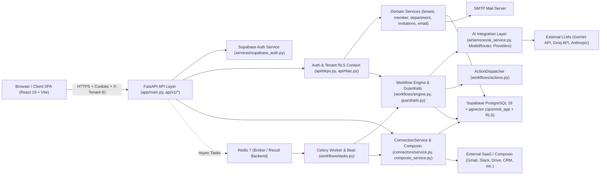
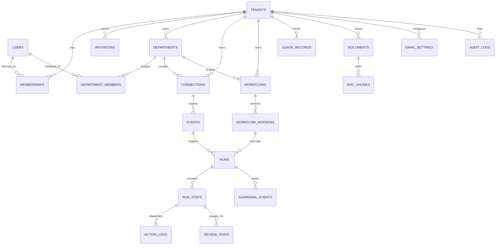
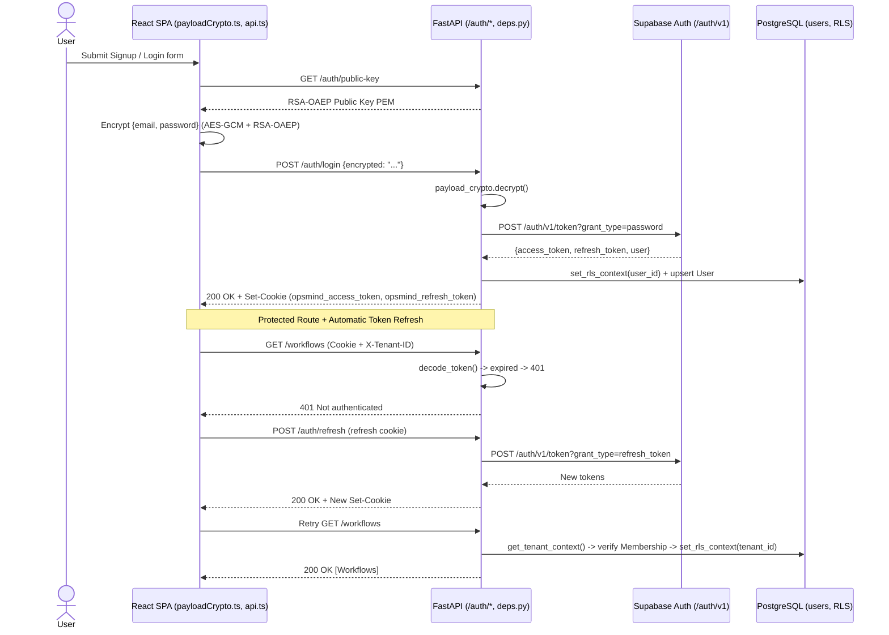
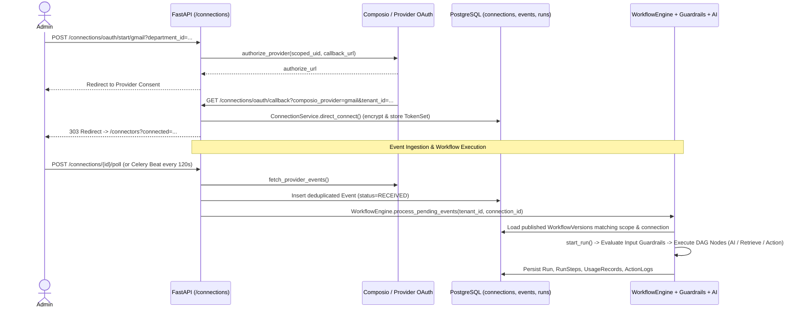
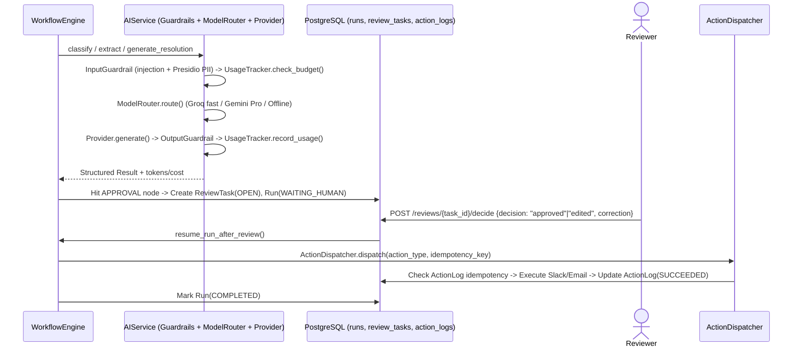
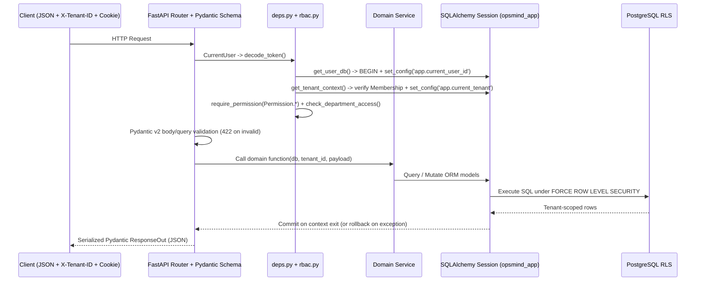
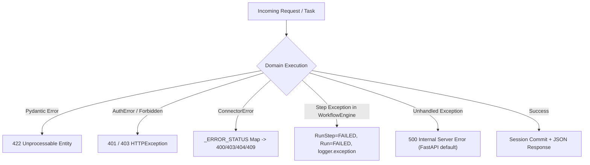
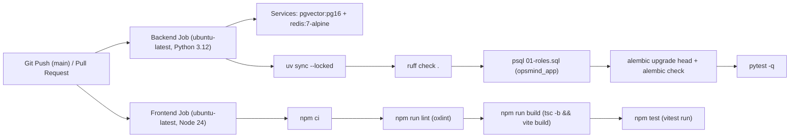
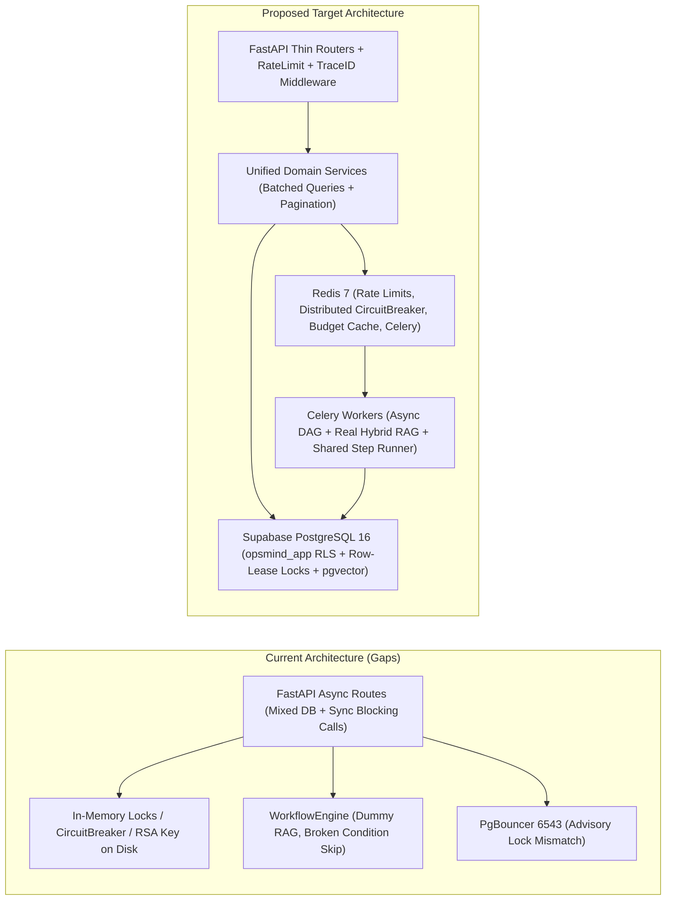

# OpsMind — Full Project Architecture & Code Review Report

> **Generated:** 2026-11-17  
> **Scope:** Complete read-only audit of `backend/`, `frontend/`, `migrations/`, `docker/`, `supabase/`, `.github/workflows/`, and `docs/`  
> **Security Note:** `.env`, key files (`.auth_rsa_key.pem`, `.certs/*`), and runtime secrets were never opened or printed; secrets handling is evaluated strictly via code references.

---

## 1. Executive Summary

**OpsMind** is an AI-native multi-tenant Operations Automation Platform (SaaS). In simple terms, it allows companies to connect their external business tools (such as Gmail, Slack, Google Drive, HubSpot, Salesforce, Stripe, Zendesk, Jira, Notion, and GitHub), organize teams into **Departments** (e.g., HR, Sales, Finance, Marketing, Support), upload internal SOP documents into a **Knowledge Base**, and build visual **no-code DAG workflows** that automatically process incoming events (like emails or tickets) using AI (classification, extraction, summarization, response drafting) with **human-in-the-loop (HITL) approvals** and **enterprise security guardrails** (prompt-injection blocking and Presidio PII redaction).

### Target Users
- **Company Owners & Admins:** Configure organization settings, SMTP, external app integrations, departments, AI budgets, member roles, and replay/audit operations.
- **Workflow Builders:** Design, version, test, and publish visual DAG workflows and manage knowledge base SOPs within their assigned departments.
- **Reviewers:** Inspect AI-proposed actions paused at Approval nodes in the Review Inbox and approve, edit, or reject them.
- **Viewers:** Read-only stakeholders monitoring dashboards, runs, and departmental operations.

### Overall Health Score: **7.4 / 10**

**Justification:**
- **Strengths (+):** Strong multi-tenant database foundation with PostgreSQL Row-Level Security (`opsmind_app` with `NOBYPASSRLS`, transaction-local `set_config`, composite tenant foreign keys `tenant_fk`), clean provider-agnostic AI architecture (`BaseAIProvider`, `ProviderRegistry`, `ModelRouter`, circuit breakers, `UsageTracker`), hybrid RSA-OAEP + AES-256-GCM auth payload encryption, AES-256-GCM credential encryption at rest with key rotation, well-structured Department RBAC isolation, and an active CI pipeline (Ruff, Alembic check, Pytest, Oxlint, Vite build, Vitest).
- **Key Gaps (-):** Critical runtime bugs in the workflow execution engine (`WorkflowEngine`: `CONDITION` nodes do not skip unchosen branches; `EXTRACT` swallows exceptions silently; `RETRIEVE` performs a dummy `LIMIT 3` query instead of vector/full-text search; `resume_run_after_review` only handles `ACTION` nodes and risks `step_index` collisions), N+1 query patterns across list/dashboard endpoints, lack of API rate limiting, in-memory-only AI circuit breakers/budget locks (not Redis-backed across workers), and session-level PostgreSQL advisory locks in `SqlConnectionRepo.lock()` that are incompatible with Supabase transaction-mode pooling (port 6543).

---
## 2. Tech Stack and Project Structure

### Tech Stack
| Layer | Technology | Evidence / File Reference |
| :--- | :--- | :--- |
| **Backend Language & Runtime** | Python 3.12+, `uv` package manager | `backend/pyproject.toml`, `.github/workflows/ci.yml` |
| **Web Framework** | FastAPI (`>=0.162.0`), Uvicorn (`>=0.54.0`), Pydantic v2 (`pydantic-settings`) | `backend/app/main.py`, `backend/app/core/config.py` |
| **Database & ORM** | Supabase PostgreSQL 16 + `pgvector` (`Vector(384)`), SQLAlchemy 2.x (`psycopg`), Alembic | `backend/app/db/session.py`, `backend/app/db/models/doc_chunk.py`, `backend/migrations/env.py` |
| **Authentication** | Supabase Auth (GoTrue HTTP API) + JWT verification (`PyJWT` HS256 / JWKS ES256/RS256/EdDSA) + HTTP-only cookies + Hybrid RSA-OAEP/AES-256-GCM login/signup payload encryption | `backend/app/services/supabase_auth.py`, `backend/app/core/security.py`, `backend/app/core/payload_crypto.py` |
| **Async Task Queue & Cache** | Celery 5.7+ + Redis 7 (`redis-alpine` in `docker-compose.yml`), Celery Beat | `backend/app/core/celery_app.py`, `backend/app/workflows/tasks.py`, `docker-compose.yml` |
| **AI Providers & Routing** | Google Gemini, Groq LPU, Anthropic (extensible), Deterministic Offline Fallback | `backend/app/ai/providers/*.py`, `backend/app/ai/routing/model_router.py` |
| **AI Guardrails & PII** | Microsoft Presidio (`presidio-analyzer`, `presidio-anonymizer`, spaCy `en_core_web_sm`) + regex/Luhn/base64 injection rules | `backend/app/workflows/guardrails.py`, `backend/app/workflows/presidio_engine.py`, `backend/app/ai/guardrails/*.py` |
| **External Integrations** | Composio SDK (`>=0.32.0`) + 11 native OAuth2/API connector adapters + `smtplib` SMTP | `backend/app/services/composio_service.py`, `backend/app/connectors/*`, `backend/app/services/email.py` |
| **Frontend** | React 19, TypeScript 7, Vite 8, Tailwind CSS v4, TanStack React Query v5, React Router v7/8, `@xyflow/react` v12, Lucide icons | `frontend/package.json`, `frontend/vite.config.ts` |
| **Testing & Linting** | Backend: `pytest`, `ruff`, `alembic check` \| Frontend: `vitest`, `oxlint`, `tsc -b` | `.github/workflows/ci.yml`, `backend/pyproject.toml`, `frontend/package.json` |

### Folder Tree & Module Purpose
```text
opsmind/
├── .github/workflows/ci.yml        # GitHub Actions CI (backend lint/migrate/test + frontend lint/build/test)
├── docker-compose.yml              # Local Redis 7 container (port 6379)
├── docker/postgres/init/           # Local CI Postgres init SQL (creates opsmind_app role)
├── supabase/                       # Production Supabase SQL setup (01_create_app_role.sql)
├── docs/                           # Architecture docs, phase specs, SRS, and this report
├── backend/
│   ├── alembic.ini                 # Alembic migration runner configuration
│   ├── pyproject.toml              # Python 3.12 dependencies, Ruff & Pytest settings
│   ├── migrations/                 # Alembic env.py + 11 versioned schema/RLS migrations
│   ├── tests/                      # 25 Pytest test modules (unit, schema, RLS, API, AI, workflows, departments)
│   └── app/
│       ├── main.py                 # FastAPI app factory (create_app), CORS, security headers, router mounting
│       ├── core/                   # Settings, JWT decode, RBAC Permission matrix, Celery app, PayloadCryptoService
│       ├── db/                     # SQLAlchemy Base, Session factory, RLS helper, enums, mixins, 22 ORM models
│       ├── api/                    # FastAPI dependencies (CurrentUser, TenantCtx, require_permission), health, v1 routers
│       ├── schemas/                # Pydantic v2 request/response schemas
│       ├── services/               # Business logic (tenant, member, invitations, department, email, supabase_auth, composio)
│       ├── ai/                     # Provider-independent AI layer (providers, routing, guardrails, services, usage)
│       ├── connectors/             # OAuth2/PKCE, AES-GCM KeyRing crypto, ingestion loop, SqlConnectionRepo, 11 adapters
│       └── workflows/              # DAG validator, WorkflowEngine, ActionDispatcher, Guardrails, Presidio, Celery tasks
└── frontend/
    ├── vite.config.ts              # HTTPS dev server (port 5173) + proxy rules to FastAPI (127.0.0.1:8000)
    ├── package.json                # React 19 + Vite + Tailwind v4 + React Query + React Flow
    └── src/
        ├── main.tsx                # React DOM mount, QueryClientProvider, BrowserRouter
        ├── App.tsx                 # Route definitions (PublicOnlyRoute, ProtectedRoute, RequireCompany, AppShell)
        ├── components/             # AppShell layout, route guards, TenantSwitcher, CustomWorkflowNode, UI primitives
        ├── lib/                    # Fetch wrapper with 401 refresh, WebCrypto RSA/AES payload encryption, API hooks & types
        └── pages/                  # 17 page components (Auth, Onboarding, Dashboard, Departments, Workflows, Reviews, KB, etc.)
```

### Entry Points
- **Backend HTTP API:** `backend/app/main.py` (`app = create_app()`) served via `uvicorn app.main:app`
- **Celery Worker / Beat:** `backend/app/core/celery_app.py` (`celery_app`) importing `backend/app/workflows/tasks.py`
- **Database Migrations:** `backend/migrations/env.py` via `alembic upgrade head`
- **Frontend SPA:** `frontend/index.html` → `frontend/src/main.tsx` → `frontend/src/App.tsx`

---

## 3. Current Implementation Status

| Feature | Status | Files |
| :--- | :--- | :--- |
| **Multi-Tenant Organization & Onboarding** | **Complete** | `backend/app/api/v1/tenants.py`, `backend/app/api/v1/current_tenant.py`, `backend/app/services/tenant.py`, `frontend/src/pages/OnboardingPage.tsx` |
| **Authentication (Signup, Login, Refresh, Logout, Password Reset)** | **Complete** | `backend/app/api/v1/auth.py`, `backend/app/services/supabase_auth.py`, `backend/app/core/security.py`, `backend/app/core/payload_crypto.py`, `frontend/src/pages/LoginPage.tsx`, `SignupPage.tsx`, `ForgotPasswordPage.tsx`, `ResetPasswordPage.tsx` |
| **Google OAuth Login (via Supabase)** | **Partial** | `SupabaseAuthService.get_google_auth_url` & `exchange_code` exist in `backend/app/services/supabase_auth.py`, but no `/auth/google` callback route is exposed in `backend/app/api/v1/auth.py` |
| **Company RBAC & Member Management** | **Complete** | `backend/app/core/permissions.py`, `backend/app/api/rbac.py`, `backend/app/api/v1/members.py`, `backend/app/services/member.py`, `frontend/src/pages/MembersPage.tsx` |
| **Member Invitations & Branded Emails** | **Complete** | `backend/app/api/v1/invitations.py`, `backend/app/services/invitations.py`, `backend/app/services/email.py`, `frontend/src/pages/AcceptInvitePage.tsx` |
| **PostgreSQL Row-Level Security (RLS)** | **Complete** | `backend/app/db/rls.py`, `backend/app/api/deps.py`, `backend/migrations/versions/*`, `supabase/01_create_app_role.sql` |
| **Department Module (CRUD, Templates, Members, Scope Isolation, Dashboard)** | **Complete** | `backend/app/db/models/department.py`, `backend/app/services/department.py`, `backend/app/api/v1/departments.py`, `frontend/src/pages/DepartmentsPage.tsx`, `DepartmentDetailPage.tsx` |
| **Connector Foundation & AES-GCM Encryption** | **Complete** | `backend/app/connectors/crypto.py`, `oauth.py`, `service.py`, `sql_repo.py`, `ingestion.py`, `backend/app/api/v1/connectors.py` |
| **External Connectors (Composio + 11 Providers)** | **Partial** | `backend/app/services/composio_service.py`, `backend/app/connectors/*/connector.py` — Gmail/Drive/Calendar OAuth relies on Composio or direct connect; Slack & Email actions work in `ActionDispatcher`; other 8 connectors lack outbound action handlers in `actions.py` |
| **AI Provider Abstraction & Model Routing** | **Complete** | `backend/app/ai/providers/*`, `backend/app/ai/routing/model_router.py`, `backend/app/ai/services/*`, `backend/app/ai/usage/*` (Anthropic stubbed as extensible) |
| **AI & Workflow Guardrails (Injection + Presidio PII)** | **Complete** | `backend/app/workflows/guardrails.py`, `presidio_engine.py`, `backend/app/ai/guardrails/input_guard.py`, `output_guard.py` |
| **Visual Workflow Builder (React Flow) & Versioning** | **Complete** | `backend/app/api/v1/workflows.py`, `backend/app/workflows/dag.py`, `templates.py`, `frontend/src/pages/WorkflowsListPage.tsx`, `WorkflowEditorPage.tsx`, `CustomWorkflowNode.tsx` |
| **Workflow Execution Engine** | **Partial** | `backend/app/workflows/engine.py`, `actions.py`, `tasks.py` — Core execution works, but `CONDITION` branching does not skip nodes, `RETRIEVE` ignores query embeddings/TSV, and `resume_run_after_review` only runs `ACTION` steps |
| **Human-in-the-Loop (HITL) Review Inbox** | **Complete** | `backend/app/api/v1/reviews.py`, `backend/app/workflows/engine.py`, `frontend/src/pages/ReviewInboxPage.tsx` |
| **Knowledge Base & RAG Retrieval** | **Partial** | `backend/app/api/v1/knowledge.py`, `backend/app/db/models/doc_chunk.py`, `frontend/src/pages/KnowledgeBasePage.tsx` — CRUD and chunking work, but embeddings are never generated (`embedding` is always NULL) and `StepType.RETRIEVE` returns first 3 chunks regardless of query |
| **Tenant SMTP Email Settings** | **Complete** | `backend/app/api/v1/email_settings.py`, `backend/app/services/email.py`, `frontend/src/pages/SettingsPage.tsx` |
| **Billing / Subscriptions & Stripe Webhooks** | **Missing** | `Subscription` model (`backend/app/db/models/subscription.py`) and `Permission.BILLING_MANAGE` exist, but no billing API routes or Stripe checkout/webhook handlers exist |
| **Tenant API Keys Management** | **Missing** | `ApiKey` model (`backend/app/db/models/api_key.py`) and `Permission.API_KEYS_MANAGE` exist, but no API key routes or auth middleware exist |
| **Eval Sets / Quality Gate Execution** | **Missing** | `EvalSet` and `EvalResult` models (`eval_set.py`, `eval_result.py`) and `WorkflowVersionStatus.GATE_PASSED` exist, but no eval runner or API endpoints exist |

---
## 4. System Design

### 4.1 Architecture Overview

OpsMind follows a **modular layered monolith** architecture on the backend (FastAPI + Celery workers) paired with a **Single Page Application (SPA)** frontend (React + Vite).

- **Presentation Layer (`frontend/`):** React 19 SPA communicating via JSON over HTTPS proxy (`vite.config.ts`) using HTTP-only cookies and the `X-Tenant-ID` header.
- **API & Security Layer (`backend/app/api/`, `core/`):** FastAPI routers enforce JWT authentication (`get_current_user`), tenant membership & RLS context (`get_tenant_context`), and RBAC permissions (`require_permission`).
- **Application Services Layer (`backend/app/services/`):** Domain services for tenants, members, invitations, departments, SMTP email, Supabase Auth, and Composio orchestration.
- **AI Integration Layer (`backend/app/ai/`):** Provider-independent `AIService` facade coordinating `InputGuardrail`, `UsageTracker`, `ModelRouter`, `ProviderRegistry` (`GeminiProvider`, `GroqProvider`, `AnthropicProvider`), and `OutputGuardrail`.
- **Workflow & Execution Layer (`backend/app/workflows/`):** Static DAG validation (`validate_dag`), synchronous/Celery execution (`WorkflowEngine`, `execute_workflow_run_task`), `EnterpriseGuardrailEngine` (regex + Presidio), and `ActionDispatcher`.
- **Connector Layer (`backend/app/connectors/`):** Isolated `ConnectionService` with PKCE OAuth2 (`oauth.py`), AES-256-GCM credential encryption (`crypto.py`), async polling (`ingestion.py`), and `SqlConnectionRepo`.
- **Persistence Layer (`backend/app/db/`):** Single Supabase PostgreSQL 16 database accessed via restricted `opsmind_app` role (`NOBYPASSRLS`) enforcing tenant isolation via PostgreSQL RLS, plus Redis 7 for Celery broker/backend.



---

### 4.2 Database Design

OpsMind uses **one PostgreSQL 16 database** (with `pgvector`) containing **22 ORM models** across `backend/app/db/models/`, managed by 11 Alembic migrations (`backend/migrations/versions/`). Almost every business table inherits `TenantScopedMixin` (`tenant_id` FK to `tenants.id ON DELETE CASCADE`) and uses composite tenant foreign keys (`tenant_fk(col, parent_table)` referencing `(tenant_id, id)`) to prevent cross-tenant linking even at the constraint level.

#### Key Tables, Columns & Constraints
- **`tenants`:** `id` (PK), `name`, `slug` (UNIQUE, regex check), `region` (`eu`/`us`), `plan` (`free`/`starter`/`pro`), `monthly_ai_cost_cap_usd` (`Numeric(12,4)`, default `5.0000`).
- **`users`:** `id` (PK, synced with Supabase Auth `sub` UUID), `email` (UNIQUE, lowercase check), `full_name`, `is_active`.
- **`memberships`:** `id`, `tenant_id`, `user_id` (FK `users.id`), `role` (`owner`/`admin`/`builder`/`reviewer`/`viewer`), `UNIQUE(tenant_id, user_id)`.
- **`invitations`:** `id`, `tenant_id`, `email` (lowercase check), `role` (`role <> 'owner'` check), `token_hash` (UNIQUE SHA-256), `expires_at`, `accepted_at`, `revoked_at`, partial unique index `uq_invitations_pending_email`.
- **`departments` & `department_members`:** `departments` has `name`, `code`, `template_key`, `status` (`active`/`inactive`/`archived`), `settings` (JSONB), `monthly_ai_cost_cap_usd`, `UNIQUE(tenant_id, code)`, `UNIQUE(tenant_id, name)`. `department_members` links `(tenant_id, department_id)` and `user_id` with `UNIQUE(tenant_id, department_id, user_id)`.
- **`connections`:** `id`, `tenant_id`, `department_id` (nullable `tenant_fk`), `provider`, `external_account_id`, `status`, `credentials_ciphertext` (`BYTEA`), `credentials_key_id`, `scopes` (`TEXT[]`), `sync_cursor`, `UNIQUE(tenant_id, provider, external_account_id)`.
- **`workflows` & `workflow_versions`:** `workflows` has `department_id`, `name`, `archived_at`, `UNIQUE(tenant_id, name)`. `workflow_versions` stores `version_number`, `definition` (JSONB), `status` (`draft`/`testing`/`gate_passed`/`published`/`paused`/`failed`/`archived`), `trigger_connection_id`, `trigger_event_type`, partial unique index `uq_workflow_versions_workflow_id_published` (1 published version per workflow).
- **`events`:** `id`, `tenant_id`, `connection_id`, `department_id`, `dedup_key`, `event_type`, `payload` (JSONB), `status` (`received`/`processed`/`ignored`/`failed`), `UNIQUE(tenant_id, connection_id, dedup_key)`.
- **`runs`, `run_steps`, `action_logs`, `review_tasks`, `guardrail_events`:** Execution telemetry and HITL tables. `runs` has `trace_id` (UNIQUE), `idempotency_key` (`UNIQUE(tenant_id, idempotency_key)`), `cost_usd`, `total_tokens`. `run_steps` has `UNIQUE(run_id, step_index, attempt)`. `action_logs` has `UNIQUE(tenant_id, idempotency_key)`. `review_tasks` has partial unique index `uq_review_tasks_tenant_id_run_step_id_open`.
- **`documents` & `doc_chunks`:** Knowledge base documents and chunks. `doc_chunks` has `content_tsv` (`TSVECTOR` generated column with GIN index) and `embedding` (`Vector(384)` with HNSW cosine index).
- **`usage_records`, `audit_logs`, `email_settings`, `api_keys`, `subscriptions`, `eval_sets`, `eval_results`, `oauth_states`:** Telemetry, append-only audit logs, encrypted per-tenant SMTP settings, billing/API key/eval tables, and PKCE OAuth nonces.



---

### 4.3 API Design

All endpoints (except `/health`, `/health/ready`, `/auth/*`, `/current_user`, `/tenants`, `/invitations/info`, `/invitations/accept`, and `/connections/oauth/callback`) require both `CurrentUser` (cookie or Bearer JWT) and `X-Tenant-ID` header (`TenantCtx`).

| Method | Path | Auth | Role / Permission | Purpose | Request / Response Summary |
| :--- | :--- | :--- | :--- | :--- | :--- |
| `GET` | `/health`, `/health/ready` | None | Public | Liveness & DB/Redis readiness | `HealthResponse` / `ReadinessResponse` (503 if degraded) |
| `GET` | `/auth/public-key` | None | Public | Fetch RSA-OAEP public PEM | `PublicKeyResponse` |
| `POST` | `/auth/signup` | None | Public | Register user in Supabase + local DB | `SignupRequest` (plaintext or `encrypted`) → `SignupResponse` + cookies |
| `POST` | `/auth/login` | None | Public | Login via Supabase Auth | `LoginRequest` → `AuthSessionResponse` + HTTP-only cookies |
| `POST` | `/auth/refresh` | Cookie | Public | Refresh Supabase session | Refresh cookie → `AuthSessionResponse` + rotated cookies |
| `POST` | `/auth/password/reset-request` | None | Public | Trigger SMTP or Supabase reset email | `PasswordResetRequest` → `MessageResponse` (202) |
| `POST` | `/auth/password/reset` | None | Token | Update password using recovery JWT | `PasswordResetConfirmRequest` → `MessageResponse` |
| `POST` | `/auth/logout` | Cookie | Public | Revoke session & clear cookies | `204 No Content` |
| `GET` | `/current_user` | JWT | Authenticated | Get user profile & tenant list | `MeOut` |
| `POST` | `/tenants` | JWT | Authenticated | Create company (max 1 per user) | `TenantCreate` → `TenantOut` (caller = Owner) |
| `GET` | `/tenant` | TenantCtx | `TENANT_READ` (All) | Read active tenant details | `TenantOut` |
| `PATCH` | `/tenant` | TenantCtx | `TENANT_MANAGE` (Owner) | Update tenant name + audit log | `TenantUpdate` → `TenantOut` |
| `GET` | `/members` | TenantCtx | `MEMBERS_READ` (All) | List members + department assignments | `list[MemberOut]` |
| `PATCH` | `/members/{user_id}` | TenantCtx | `MEMBERS_MANAGE` (Owner/Admin) | Change member role (last-owner guarded) | `MemberRoleUpdate` → `MemberOut` |
| `DELETE` | `/members/{user_id}` | TenantCtx | Self or `MEMBERS_MANAGE` | Remove member & department links | `204 No Content` |
| `GET` | `/invitations/info` | None | Public | Inspect invitation token metadata | `?token=` → `InvitationInfoOut` |
| `POST` | `/invitations` | TenantCtx | `MEMBERS_MANAGE` | Create invitation + send SMTP email | `InvitationCreate` → `InvitationCreated` |
| `GET` | `/invitations` | TenantCtx | `MEMBERS_MANAGE` | List pending invitations | `list[InvitationOut]` |
| `POST` | `/invitations/accept` | JWT | Email match | Accept invite & join tenant | `InvitationAccept` → `TenantOut` |
| `DELETE` | `/invitations/{id}` | TenantCtx | `MEMBERS_MANAGE` | Revoke pending invitation | `204 No Content` |
| `GET` | `/departments/templates` | TenantCtx | Authenticated | List 5 starter dept templates | `list[DepartmentTemplateOut]` |
| `GET` | `/departments` | TenantCtx | Owner/Admin: all; others: assigned | List departments with counts | `list[DepartmentOut]` |
| `POST` | `/departments` | TenantCtx | Owner/Admin | Create department | `DepartmentCreate` → `DepartmentOut` |
| `GET` | `/departments/{id}` | TenantCtx | Dept access check | Get department details | `DepartmentOut` |
| `GET` | `/departments/{id}/dashboard` | TenantCtx | Dept access check | Operational metrics, runs, AI spend | `DepartmentDashboardOut` |
| `PATCH` | `/departments/{id}` | TenantCtx | Owner/Admin | Update name, settings, cost cap | `DepartmentUpdate` → `DepartmentOut` |
| `POST` | `/departments/{id}/activate\|deactivate\|archive` | TenantCtx | Owner/Admin | Lifecycle transitions (pauses workflows) | `DepartmentOut` |
| `GET/POST/DELETE` | `/departments/{id}/members` | TenantCtx | Read: member; Write: Owner/Admin | List, assign, remove dept members | `list[DepartmentMemberOut]` / `204` |
| `GET` | `/connections` | TenantCtx | `CONNECTIONS_READ` + dept filter | List connections (no credentials) | `list[ConnectionView]` |
| `POST` | `/connections/oauth/start/{provider}` | TenantCtx | `CONNECTIONS_MANAGE` + dept | Start Composio or native PKCE OAuth | `{"authorize_url": ...}` |
| `GET` | `/connections/oauth/callback` | State/Query | Callback | Complete OAuth & encrypt tokens | Redirect to `/connectors` or `ConnectionView` |
| `POST` | `/connections/direct` | TenantCtx | `CONNECTIONS_MANAGE` + dept | Connect via API key / token | `DirectConnectRequest` → `ConnectionView` |
| `POST` | `/connections/composio/execute` | TenantCtx | `CONNECTIONS_MANAGE` | Execute Composio tool directly | `ComposioExecuteRequest` → `dict` |
| `GET/POST/DELETE` | `/connections/{id}` | TenantCtx | Read / Manage | Health check, manual poll, revoke/delete | `ConnectionView` / poll stats / `204` |
| `POST/GET/PATCH/DELETE` | `/workflows*` | TenantCtx | `WORKFLOWS_READ/WRITE/PUBLISH` + dept | Validate DAG, templates, CRUD, versions, publish, pause | `WorkflowOut` / `WorkflowVersionOut` |
| `POST` | `/runs/workflows/{id}/execute` | TenantCtx | `WORKFLOWS_READ` + dept write | Execute workflow (sync or Celery) | `RunTriggerRequest` → `RunOut` |
| `GET` | `/runs`, `/runs/{id}` | TenantCtx | `RUNS_READ` + dept filter | List runs & inspect step telemetry | `list[RunOut]` / `RunOut` |
| `GET/POST` | `/reviews`, `/reviews/{id}/decide` | TenantCtx | `REVIEWS_READ` / `REVIEWS_DECIDE` | List HITL tasks; approve/edit/reject | `list[ReviewTaskOut]` / `ReviewTaskOut` |
| `GET/POST/DELETE` | `/knowledge` | TenantCtx | `KNOWLEDGE_READ` / `KNOWLEDGE_WRITE` | List, upload+chunk SOP docs, delete | `list[KnowledgeDocumentOut]` / `204` |
| `GET/PUT/POST` | `/settings/email`, `/settings/email/test` | TenantCtx | `CONNECTIONS_MANAGE` | View/update encrypted SMTP, send test | `EmailSettingOut` / `TestEmailResponse` |

---

### 4.4 Authentication and Authorization Design

- **Authentication (`backend/app/core/security.py`, `api/v1/auth.py`, `api/deps.py`):**
  - Users authenticate against Supabase Auth (`SupabaseAuthService`).
  - Login/Signup credentials can be encrypted client-side (`frontend/src/lib/payloadCrypto.ts`) using RSA-OAEP (2048-bit, SHA-256) + AES-256-GCM before transmission and decrypted by `PayloadCryptoService` (`backend/app/core/payload_crypto.py`).
  - FastAPI issues HTTP-only cookies (`opsmind_access_token` with `max_age=expires_in`, `opsmind_refresh_token` with 30-day `max_age`, `samesite="lax"`). `get_current_user()` accepts either `Authorization: Bearer <jwt>` or the access cookie.
  - `decode_token()` verifies `HS256` (via `SUPABASE_JWT_SECRET`) or asymmetric `ES256`/`RS256`/`EdDSA` (via cached `PyJWKClient` JWKS with 1-hour lifespan), enforcing `exp`, `sub`, `aud`, `iss`, and 10s leeway.
- **Authorization (RBAC + Department Scope + PostgreSQL RLS):**
  - **Company Roles (`backend/app/core/permissions.py`):** 5 roles (`owner`, `admin`, `builder`, `reviewer`, `viewer`) mapped to 21 granular `Permission` strings in `PERMISSION_ROLES`. Enforced by `require_permission(...)` in `backend/app/api/rbac.py`.
  - **Department Scope (`backend/app/services/department.py`):** `check_department_access()` grants `owner`/`admin` full access to all departments, while `builder`, `reviewer`, and `viewer` can only access departments present in `department_members`. `viewer` and `reviewer` are blocked from `require_write=True`.
  - **Database RLS (`backend/app/db/rls.py`, `api/deps.py`):** `get_user_db()` sets transaction-local `app.current_user_id`; `get_tenant_context()` verifies active `Membership` + `User.is_active` and sets `app.current_tenant`. FastAPI connects as `opsmind_app` (`NOBYPASSRLS`).

---

### 4.5 External Integrations and Configuration Management

- **Configuration (`backend/app/core/config.py`):** Managed via `pydantic-settings` (`Settings`), reading `.env` and `backend/.env` with `@lru_cache` (`get_settings()`). Validates `AUTH_COOKIE_SECURE=true` in production, positive timeouts, and confidence bounds (`0.0–1.0`).
- **Composio SDK (`backend/app/services/composio_service.py`):** When `COMPOSIO_API_KEY` is configured, OAuth flows (`authorize_provider`), tool discovery, and Gmail/Drive polling (`GMAIL_FETCH_EMAILS`, `GOOGLEDRIVE_FIND_FILE`) and Gmail sending (`GMAIL_SEND_EMAIL`) delegate to Composio using scoped `user_id` (`{tenant_id}` or `{tenant_id}:dept:{department_id}`).
- **Native Connectors (`backend/app/connectors/`):** 11 connector implementations (`gmail`, `google_drive`, `google_calendar`, `slack`, `hubspot`, `salesforce`, `stripe`, `zendesk`, `jira`, `notion`, `github`) with PKCE OAuth2 + encrypted `TokenSet` storage using `KeyRing` (AES-256-GCM with AAD `"{tenant_id}:{connection_id}"` and key rotation support).
- **AI Providers (`backend/app/ai/providers/`):** `GeminiProvider` (Google Generative Language API), `GroqProvider` (OpenAI-compatible Groq API), `AnthropicProvider` (extensible stub/adapter), plus deterministic offline fallback.
- **SMTP (`backend/app/services/email.py`):** Per-tenant `EmailSetting` (with AES-GCM encrypted `smtp_password`) takes precedence over system `SMTP_*` env vars; falls back to simulation mode if `smtp_host` is empty.

---
## 5. Full Workflow

### 5.1 Authentication Flow (Register, Login, Refresh, Protected Route)

The frontend fetches the backend's RSA public key (`GET /auth/public-key`), encrypts credentials client-side with AES-256-GCM + RSA-OAEP (`encryptAuthPayload`), and posts to `/auth/signup` or `/auth/login`. The backend decrypts, forwards to Supabase Auth, syncs the `users` table under RLS, and sets HTTP-only cookies. On `401` responses from protected routes, `frontend/src/lib/api.ts` (`refreshSession`) deduplicates a `POST /auth/refresh` call and retries once.



---

### 5.2 Main Business Flows

#### Flow A: Connector OAuth, Event Polling & Automated Workflow Execution
Admins connect an external provider (e.g., Gmail or Slack) via Composio or native PKCE OAuth. Polling (`POST /connections/{id}/poll` or Celery Beat `poll_all_connectors_task`) fetches new events, deduplicates them in `events`, and invokes `WorkflowEngine.process_pending_events()`, which matches `department_id` and `trigger_connection_id` to published workflows and runs `WorkflowEngine.start_run()`.



#### Flow B: AI Step Execution & Human-in-the-Loop (HITL) Approval + Resume
When `WorkflowEngine.start_run()` hits an `APPROVAL` node, it creates an open `ReviewTask` and pauses the `Run` in `WAITING_HUMAN` status. A Reviewer opens the Review Inbox, approves or edits the proposal (`POST /reviews/{id}/decide`), and `WorkflowEngine.resume_run_after_review()` dispatches downstream `ACTION` steps via `ActionDispatcher` (with idempotency key checks).



---

### 5.3 Data Flow (Request -> Validation -> Service -> DB -> Response)



---

### 5.4 Error Handling and Logging Flow

- **API Errors:** Route handlers and services raise `HTTPException` (`400/401/403/404/409/422/502/503`) or domain exceptions (`ConnectorError` mapped via `_ERROR_STATUS` in `api/v1/connectors.py`; `SupabaseAuthError` mapped via `_provider_error` in `api/v1/auth.py`). Unhandled exceptions bubble to FastAPI's default 500 handler (which is why `DELETE /connections/{id}?permanent=true` or uncaught errors return plain-text `Internal Server Error`).
- **Workflow Execution Errors:** `WorkflowEngine.start_run()` wraps each DAG step in `try/except Exception`, marks `RunStep.status = FAILED` and `Run.status = FAILED`, and persists `error`. However, `StepType.EXTRACT` catches and suppresses exceptions (`ext_res = None`), and `resume_run_after_review()` lacks a step-level `try/except`.
- **Logging:** Standard Python `logging.getLogger("opsmind.*")` across modules (`opsmind.engine`, `opsmind.ai.*`, `opsmind.email`, `opsmind.composio`, `opsmind.guardrails`). No centralized structured JSON log formatter or OpenTelemetry/Sentry sink is configured.



---

### 5.5 Deployment and CI/CD Flow

Local development uses `docker-compose.yml` for Redis 7, Vite HTTPS dev server (`frontend/vite.config.ts` with self-signed certs in `frontend/.certs/`) proxying API routes to Uvicorn (`127.0.0.1:8000`), and Supabase PostgreSQL + Auth. CI is automated via GitHub Actions (`.github/workflows/ci.yml`) on every `push` to `main` and `pull_request`:



---
## 6. Code Quality Analysis

### Strengths
1. **Clean Tenant & Schema Discipline:** `TenantScopedMixin` (`backend/app/db/mixins.py`) and `tenant_fk()` (`backend/app/db/fk.py`) enforce multi-tenant isolation at both ORM and PostgreSQL foreign-key constraint levels.
2. **Decoupled AI & Connector Abstractions:** `BaseAIProvider` + `ProviderRegistry` + `ModelRouter` (`backend/app/ai/`) and `ConnectionService` + `AdminRepo` (`backend/app/connectors/service.py`) separate business orchestration from HTTP transport and persistence.
3. **Clear RBAC & Department Access Helpers:** `PERMISSION_ROLES` (`backend/app/core/permissions.py`) and `check_department_access()` (`backend/app/services/department.py`) centralize role and department-level authorization cleanly.
4. **Type Safety & Linting:** Backend uses Python 3.12 type hints (`from __future__ import annotations`) + Ruff; Frontend uses TypeScript (`tsc -b`), `oxlint`, and React Query hooks (`frontend/src/lib/*Api.ts`).

### Weaknesses, Code Smells & Duplication
1. **Duplicate Guardrail Logic:** Prompt injection and PII sanitization exist in two separate places: `EnterpriseGuardrailEngine` (`backend/app/workflows/guardrails.py`) and `InputGuardrail` / `OutputGuardrail` (`backend/app/ai/guardrails/input_guard.py`, `output_guard.py`). Both run during workflow AI steps, causing redundant regex/Presidio scans.
2. **Heavy Route Handlers Mixing DB & Business Logic:** While `tenant.py`, `member.py`, `invitations.py`, and `department.py` have dedicated service modules, `workflows.py`, `knowledge.py`, `reviews.py`, `email_settings.py`, and `connectors.py` contain inline SQLAlchemy queries, audit-log inserts, and serialization logic directly inside FastAPI route functions.
3. **Sync/Async Bridging Workaround:** `WorkflowEngine` is synchronous (`Session`), while `AIService` and `ConnectionService` are `async`. `engine.py` and `tasks.py` use `_run_coroutine_sync()` (`asyncio.run` / `ThreadPoolExecutor`), which adds thread-hopping overhead and creates a mismatch with `SqlConnectionRepo` (which uses a separate `create_async_engine`).
4. **Silent Fallback / Placeholder Credentials in Factory:** `_build_service()` in `backend/app/api/v1/connectors.py` passes `"placeholder_client_id"` / `"placeholder_secret"` when env vars are missing, which only fails later at external OAuth token exchange if `PROVIDER_ENV_KEYS` check is bypassed.
5. **Dual DB Connection / Raw SQL in `_audit()` and `poll_connection()`:** `backend/app/api/v1/connectors.py` (`_audit`, `poll_connection`) opens new synchronous sessions via `get_session_factory()` inside `async def` routes, blocking the FastAPI event loop.

---

## 7. Bugs and Risky Logic

1. **`StepType.CONDITION` Does Not Skip Unchosen Branches**
   - **Location:** `backend/app/workflows/engine.py` — `WorkflowEngine.start_run()` (lines 169–173, 344–352)
   - **Description:** `skipped_nodes: set[str]` is initialized on line 169 and checked on line 172, but `elif node.type == StepType.CONDITION:` only sets `step.output = {"condition_evaluated": cond_passed, ...}` and never traverses outgoing edges to add the untaken branch's nodes to `skipped_nodes`.
   - **Why it is a problem:** Both true and false branches of a Condition node always execute unconditionally, breaking conditional workflow routing.
   - **Suggested fix:** Inspect `dag.edges` where `edge.source == node.id` (using `edge.condition` / `edge.source_handle`), determine which branch was not taken, and BFS/DFS its exclusive descendants into `skipped_nodes`.

2. **`StepType.RETRIEVE` Performs Dummy `LIMIT 3` Query Instead of RAG Search**
   - **Location:** `backend/app/workflows/engine.py` — `WorkflowEngine.start_run()` (lines 274–304); `backend/app/api/v1/knowledge.py` — `create_knowledge_document()` (lines 134–145)
   - **Description:** `create_knowledge_document()` never generates vector embeddings (`DocChunk.embedding` stays `NULL`), and `StepType.RETRIEVE` executes `SELECT DocChunk, Document ... ORDER BY DocChunk.chunk_index ASC LIMIT 3` with no query filter, full-text `content_tsv` match, or pgvector cosine distance.
   - **Why it is a problem:** Every workflow `RETRIEVE` node returns the exact same first 3 chunks of the knowledge base regardless of the incoming customer message or question.
   - **Suggested fix:** Use `DocChunk.content_tsv.op("@@")(func.plainto_tsquery("english", query))` (and/or generate embeddings for `DocChunk.embedding` + pgvector cosine similarity) to rank relevant chunks.

3. **`StepType.EXTRACT` Silently Swallows All Exceptions**
   - **Location:** `backend/app/workflows/engine.py` — `WorkflowEngine.start_run()` (lines 253–255, 272)
   - **Description:** `except Exception: ext_res = None` catches all errors—including `AIUsageLimitExceededError`, `AIGuardrailBlockedError`, and `AIAuthenticationError`—and still marks `step.status = RunStepStatus.COMPLETED`.
   - **Why it is a problem:** Budget enforcement, security blocks, and provider failures are silently ignored for Extract steps.
   - **Suggested fix:** Remove the broad `try/except` so the outer step `except Exception` marks the step and run as `FAILED` (or re-raise `AIUsageLimitExceededError` and `AIGuardrailBlockedError`).

4. **`resume_run_after_review()` Only Executes `ACTION` Nodes & Risks `step_index` Collision**
   - **Location:** `backend/app/workflows/engine.py` — `WorkflowEngine.resume_run_after_review()` (lines 485–528)
   - **Description:** After an `APPROVAL` node, the loop skips any non-`ACTION` nodes, hardcodes `step_index = approval_step.step_index + 1`, and has no `try/except` around `ActionDispatcher.dispatch()`.
   - **Why it is a problem:** Workflows with multiple post-approval steps (e.g., two `ACTION` nodes or an `AGENT` + `ACTION` chain) will either skip nodes or crash with `UniqueConstraint("run_id", "step_index", "attempt")` `IntegrityError` on `run_steps`.
   - **Suggested fix:** Increment `step_index` dynamically from `approval_step.step_index`, support all downstream `StepType` handlers via a shared step-runner helper, and wrap step execution in `try/except` to transition `Run` to `FAILED` cleanly on error.

5. **PostgreSQL Session-Level Advisory Locks Incompatible with Supabase Transaction Pooler (Port 6543)**
   - **Location:** `backend/app/connectors/sql_repo.py` — `SqlConnectionRepo.lock()` (lines 88–100)
   - **Description:** Uses `pg_try_advisory_lock(hashtext(:id))` and `pg_advisory_unlock(hashtext(:id))`. As noted in the file's own docstring, session-level advisory locks fail or leak locks across pooled connections in transaction-mode PgBouncer (port 6543).
   - **Why it is a problem:** Concurrent connector polls in production Supabase environments can either fail to unlock or allow duplicate concurrent polls.
   - **Suggested fix:** Replace with `pg_try_advisory_xact_lock` inside a transaction or a `lock_until` timestamp column on `connections` using `UPDATE ... WHERE lock_until IS NULL OR lock_until < now()`.

6. **In-Memory `UsageTracker` State & `ai_free_tier_mode` Budget Bypass**
   - **Location:** `backend/app/ai/usage/usage_tracker.py` — `UsageTracker.record_usage()` (lines 22–25, 167–175)
   - **Description:** `_TENANT_LOCKS`, `_IN_MEMORY_SPEND`, and `_IN_MEMORY_CAP` are process-local Python dicts. Furthermore, `is_free = get_settings().ai_free_tier_mode and not has_explicit_cap` forces `cost_usd = $0.00` whenever `ai_free_tier_mode=True` (the default in `config.py`), even if a tenant has `Tenant.monthly_ai_cost_cap_usd` configured in Postgres.
   - **Why it is a problem:** Multi-worker deployments do not share `_IN_MEMORY_SPEND`, and `ai_free_tier_mode=True` prevents accurate cost tracking against DB tenant/department caps.
   - **Suggested fix:** Use Redis or DB-backed cost calculation based on `Tenant.plan` rather than `_IN_MEMORY_CAP`, and ensure `UsageTracker` relies on DB `with_for_update()` / Redis distributed locks.

7. **Connection Uniqueness Constraint Conflicts with Multi-Department Connections**
   - **Location:** `backend/app/db/models/connection.py` (line 19) & `backend/app/connectors/service.py` (`direct_connect`, line 143)
   - **Description:** `connections` has `UniqueConstraint("tenant_id", "provider", "external_account_id")` without `department_id`, and `find_by_account()` searches by `(tenant_id, provider, account_id)`.
   - **Why it is a problem:** Connecting the same Gmail/Slack account to a second department overwrites the existing connection's `department_id`, silently moving it out of the first department.
   - **Suggested fix:** Include `department_id` in uniqueness checks (or explicitly reject with `409 Conflict` if that account is already bound to another department).

8. **Silent Exception Swallowing in `runs.py` Background Dispatch**
   - **Location:** `backend/app/api/v1/runs.py` — `trigger_workflow_run()` (lines 46–58)
   - **Description:** `except Exception: pass` when `background=True` silently falls back to synchronous execution even if the Celery task timed out (`async_res.get(timeout=15)`) after already starting in the worker.
   - **Why it is a problem:** Can cause duplicate workflow execution (once in Celery, once synchronously in the API request).
   - **Suggested fix:** Only fall back on broker connection errors (`KombuError`/`OperationalError`) before enqueueing, or return `202 Accepted` with `run_id` without blocking on `.get(timeout=15)`.

---

## 8. Security Analysis

| Area | Assessment | Exact Finding & File Reference |
| :--- | :--- | :--- |
| **Authentication & Tokens** | **Strong** | Supabase JWT verified in `decode_token()` (`backend/app/core/security.py`) with explicit `alg` allowlist (`HS256` or `ES256`/`RS256`/`EdDSA` via JWKS), `aud`, `iss`, `exp` required. HTTP-only cookies used (`_set_session_cookies` in `api/v1/auth.py`). |
| **Client-Side Auth Encryption** | **Strong** | `PayloadCryptoService` (`backend/app/core/payload_crypto.py`) + `encryptAuthPayload()` (`frontend/src/lib/payloadCrypto.ts`) encrypt login/signup credentials with RSA-OAEP + AES-256-GCM so plaintext passwords are hidden in browser network logs. |
| **Password Policy** | **Good** | Enforces minimum 12 characters in `_resolve_signup_credentials()` (`api/v1/auth.py`, lines 181, 191); delegates hashing/storage to Supabase Auth. |
| **Multi-Tenant Isolation (RLS)** | **Strong** | Runtime DB uses `opsmind_app` (`NOBYPASSRLS`) with `set_rls_context()` (`app/db/rls.py`, `api/deps.py`) and composite `tenant_fk` constraints. Cross-tenant email lookup function was intentionally dropped in migration `f62c3a95d7b1`. |
| **RBAC & Department Isolation** | **Strong** | `require_permission()` (`api/rbac.py`) + `check_department_access()` (`services/department.py`). Event routing in `WorkflowEngine.process_pending_events()` strips untrusted `tenant_id`/`department_id` from external payloads and resolves department strictly from the DB `Connection` record. |
| **Secrets & Credential Encryption** | **Needs Review** | Connector tokens (`connectors/crypto.py`) and tenant SMTP passwords (`services/email.py`) use AES-256-GCM with AAD `tenant_id:connection_id` and key rotation. **However**, `.env` and `.auth_rsa_key.pem` exist in `backend/` — **secrets handling needs review** (ensure `.auth_rsa_key.pem` is gitignored/mounted securely in multi-replica prod, as each replica generating its own key breaks login!). |
| **CORS & Security Headers** | **Good** | `main.py` restricts CORS origins to `frontend_url` + localhost:5173, `allow_credentials=True`, explicit methods/headers, and sets `X-Content-Type-Options: nosniff`, `X-Frame-Options: DENY`, `Referrer-Policy`, and `HSTS` (when `not debug`). |
| **Rate Limiting** | **Missing (High Risk)** | No rate limiting middleware (e.g., `slowapi` or Redis token bucket) exists on `/auth/login`, `/auth/signup`, `/auth/password/reset-request`, `/invitations`, or `/runs/*/execute`. Vulnerable to brute-force / DoS / AI cost exhaustion. |
| **SQL Injection** | **Low Risk** | ORM queries use parameterized SQLAlchemy expressions; raw SQL in `sql_repo.py`, `auth.py`, and `invitations.py` uses bound parameters (`:id`, `:email`, `:h`). |
| **Sensitive Data Exposure** | **Medium Risk** | `backend/app/api/v1/runs.py` line 75 returns raw exception string `f"Failed to execute workflow: {exc}"` in HTTP 500; `connectors.py` line 348 returns raw Composio exception string in 502; `AuditLog` in `connections.py` logs full `payload` at `INFO` level. |
| **CSRF Protection** | **Medium Risk** | Cookies use `samesite="lax"` (`config.py` line 30), which mitigates basic cross-site POSTs, but there is no explicit CSRF token for cookie-authenticated state-changing requests if `samesite="none"` were ever enabled. |
| **Password Reset JWT Signing** | **Risky** | `request_password_reset()` (`api/v1/auth.py` lines 282–295) mints a 15-minute `HS256` JWT using `settings.supabase_jwt_secret` directly when custom SMTP is configured, bypassing Supabase's single-use recovery token tracking (replayable within 15 mins until password changes, though `confirm_password_reset` calls `logout`). |

---
## 9. Performance and Scalability

1. **N+1 Query Patterns Across Multiple Core Endpoints (High Impact):**
   - `backend/app/services/department.py` — `list_departments()` calls `_enrich_department()` per department, executing 4 separate `SELECT COUNT(*)` queries per department ($4N + 1$ queries).
   - `backend/app/services/department.py` — `get_department_dashboard()` loops over `wf_rows` querying `WorkflowVersion` per workflow, and executes 4 separate `COUNT(*)` queries for `Run` statuses instead of conditional `CASE` aggregation.
   - `backend/app/api/v1/workflows.py` — `list_workflows()` calls `_serialize_workflow()` per workflow, running a `WorkflowVersion` query for every workflow ($N + 1$).
   - `backend/app/api/v1/knowledge.py` — `list_knowledge_documents()` runs 2 queries (`chunk_count` and `first_chunk`) per document ($2N + 1$).
   - `backend/app/api/v1/reviews.py` — `list_review_tasks()` runs `db.get(Run)`, `db.get(WorkflowVersion)`, and `db.get(Workflow)` inside the loop for every task ($3N + 1$).
2. **Blocking I/O Inside Async Endpoints:**
   - `backend/app/api/v1/connectors.py` — `start_oauth()`, `finish_oauth()`, `poll_connection()`, and `execute_composio_tool()` are `async def` routes, yet call synchronous `composio_service.*` (blocking `httpx`/SDK calls), synchronous `get_session_factory()` DB transactions, and synchronous `WorkflowEngine.process_pending_events()`. This blocks Uvicorn's async event loop under concurrency.
   - `backend/app/services/supabase_auth.py` — `SupabaseAuthService._request()` uses synchronous `httpx.request()`, and `backend/app/workflows/actions.py` uses synchronous `httpx.get`/`httpx.post`.
3. **Missing Pagination:**
   - `list_departments` (`departments.py`), `list_workflows` (`workflows.py`), `list_knowledge_documents` (`knowledge.py`), `list_review_tasks` (`reviews.py`), `list_members` (`members.py`), and `list_connections` (`connectors.py`) return unbounded lists without `limit`/`offset` or cursor pagination.
4. **In-Memory Single-Process State Preventing Horizontal Scaling:**
   - `PayloadCryptoService` (`core/payload_crypto.py`) persists `.auth_rsa_key.pem` to local disk; multiple container replicas without a shared volume or env-injected key will have mismatched RSA keys.
   - `CircuitBreaker` (`ai/providers/base.py`), `UsageTracker._TENANT_LOCKS`/`_IN_MEMORY_SPEND` (`ai/usage/usage_tracker.py`), and `composio_service._SESSION_CACHE` (`services/composio_service.py`) are process-local memory and will not share state across multiple Uvicorn workers or Celery workers.
5. **Missing Composite Indexes on Hot Paths:**
   - `WorkflowVersion`: `workflow_versions` has `(tenant_id, workflow_id)` lookups in `_serialize_workflow` without a dedicated composite index on `(tenant_id, workflow_id, version_number)`.
   - `DocChunk`: `list_knowledge_documents` queries `(tenant_id, document_id, chunk_index)`, which is partially covered by `ix_doc_chunks_tenant_id_document_id`, while `embedding` HNSW index is unused until vector embeddings are populated.
6. **Celery Beat Polling Bottleneck:**
   - `poll_all_connectors_task()` (`workflows/tasks.py`) uses `settings.database_url` (owner role bypassing RLS) and loads all `HEALTHY` connections in one query without batching, then fans out `poll_connector_task.delay()`. At scale, this should be chunked/paginated.

---

## 10. Testing, Error Handling and Observability Gaps

### Existing Test Coverage
- **Backend (`backend/tests/`):** 25 test files covering health, models, migrations, RLS isolation (`test_rls_isolation.py`), RBAC (`test_rbac_api.py`, `test_permissions.py`), Auth/Signup (`test_auth_api.py`, `test_signup.py`, `test_payload_encryption.py`), Members/Invitations (`test_members_invitations.py`), Connectors (`test_connectors_foundation.py`, `test_all_connectors.py`, `test_gmail_and_ingestion.py`), AI (`test_ai_architecture.py`), Workflows & Execution (`test_workflows_api.py`, `test_phase5_execution_engine.py`, `test_phase5_and_6_completion.py`), and Departments (`test_departments_module.py`).
- **Frontend (`frontend/src/lib/api.test.ts`):** Only 1 test file (8 unit tests for `api()` fetch wrapper and `getErrorMessage()`).

### Testing Gaps
1. **Frontend Component & Page Tests (Missing):** Zero React Testing Library tests for all 17 pages (`LoginPage`, `WorkflowEditorPage`, `DepartmentsPage`, `MembersPage`, `ConnectionsPage`, `ReviewInboxPage`, etc.) and route guards (`routes.tsx`).
2. **Celery Task & Async Integration Tests (Gap):** `poll_all_connectors_task`, `poll_connector_task`, and `execute_workflow_run_task` in `workflows/tasks.py` are not tested end-to-end with a Celery worker/Redis broker.
3. **Edge-Case Workflow Execution Tests (Gap):** No test verifies that a `CONDITION` node actually skips the untaken branch (which is why the `CONDITION` bug went undetected), nor multi-step post-approval `resume_run_after_review()` execution.
4. **Live Provider Contract Tests:** AI and connector tests rely heavily on mocked HTTP transports; there is no scheduled/optional smoke suite for live Gemini/Groq/Composio schemas.

### Error Handling & Observability Gaps
1. **No Global Exception Handler / Request ID Middleware:** `backend/app/main.py` does not attach a `X-Request-ID` / `trace_id` correlation middleware or a global exception handler returning structured JSON `{detail, trace_id}` on 500s.
2. **Unstructured Plain-Text Logging:** Logs use default Python `logging` format without JSON formatting, tenant/user context injection, or log aggregation hooks.
3. **No Metrics / APM / Alerting:** No Prometheus `/metrics` endpoint, OpenTelemetry tracing, or Sentry error reporting is configured. Health check (`/health/ready` in `api/health.py`) checks Postgres and Redis, but does not report Celery worker availability.

---
## 11. Severity Table

| Issue | Severity | Category | File | Fix Summary |
| :--- | :--- | :--- | :--- | :--- |
| `CONDITION` node never populates `skipped_nodes`; both branches always execute | **High** | Bug / Logic | `backend/app/workflows/engine.py` (`WorkflowEngine.start_run`) | Traverse outgoing edges of `CONDITION` node and add unchosen branch descendants to `skipped_nodes`. |
| `RETRIEVE` node ignores query & performs dummy `LIMIT 3` chunk fetch | **High** | Bug / AI-RAG | `backend/app/workflows/engine.py` (`start_run`), `backend/app/api/v1/knowledge.py` | Implement `content_tsv` full-text search and/or pgvector cosine similarity on `DocChunk.embedding`. |
| `EXTRACT` step silently swallows all exceptions (`except Exception: ext_res = None`) | **High** | Bug / Security | `backend/app/workflows/engine.py` (`start_run`) | Remove broad catch so budget/guardrail/provider errors fail the step and run properly. |
| `resume_run_after_review` skips non-`ACTION` steps, hardcodes `step_index`, lacks `try/except` | **High** | Bug / Logic | `backend/app/workflows/engine.py` (`resume_run_after_review`) | Extract shared step-execution helper, increment `step_index`, and wrap dispatch in `try/except`. |
| No rate limiting on Auth, Invitations, or Workflow execution endpoints | **High** | Security | `backend/app/main.py`, `backend/app/api/v1/auth.py`, `runs.py` | Add Redis-backed rate limiting middleware (e.g. `slowapi` or custom Redis sliding window). |
| `SqlConnectionRepo.lock()` uses session-level `pg_try_advisory_lock` (breaks on PgBouncer port 6543) | **High** | Scalability / Bug | `backend/app/connectors/sql_repo.py` (`SqlConnectionRepo.lock`) | Replace with transaction-scoped `pg_try_advisory_xact_lock` or DB `lock_until` row lease. |
| Multi-replica RSA key mismatch (`.auth_rsa_key.pem` generated on local disk) | **Medium** | Security / Scaling | `backend/app/core/payload_crypto.py` (`PayloadCryptoService`) | Load RSA private key from env/secrets manager (`AUTH_RSA_PRIVATE_KEY_PEM`) with disk fallback only in dev. |
| N+1 query loops across `departments`, `workflows`, `knowledge`, `reviews` | **Medium** | Performance | `backend/app/services/department.py`, `api/v1/workflows.py`, `knowledge.py`, `reviews.py` | Replace per-item queries with `GROUP BY` / `JOIN` / `CASE` aggregations and eager loading. |
| Blocking sync Composio/DB/HTTP calls inside `async def` connector routes | **Medium** | Performance | `backend/app/api/v1/connectors.py` | Convert sync routes to `def` (FastAPI threadpool) or use `run_in_threadpool` / `httpx.AsyncClient`. |
| `UsageTracker` in-memory locks/spend & `ai_free_tier_mode` bypasses DB cost caps | **Medium** | Scalability / Logic | `backend/app/ai/usage/usage_tracker.py` | Move rate/budget state to Redis/DB `Tenant.plan` instead of process-local dicts. |
| `connections` `UNIQUE(tenant_id, provider, external_account_id)` overwrites across departments | **Medium** | Bug / Isolation | `backend/app/db/models/connection.py`, `connectors/service.py` | Scope uniqueness or reject cross-department account reuse with `409 Conflict`. |
| Duplicate guardrail engines (`EnterpriseGuardrailEngine` + `InputGuardrail`) | **Medium** | Code Quality | `backend/app/workflows/guardrails.py`, `ai/guardrails/input_guard.py` | Consolidate into one shared guardrail service called once per boundary. |
| `runs.py` `background=True` swallows timeout and re-runs synchronously | **Medium** | Bug / Reliability | `backend/app/api/v1/runs.py` (`trigger_workflow_run`) | Return `202 Accepted` on Celery enqueue; only fallback on broker connection error. |
| Unbounded list endpoints missing pagination | **Medium** | Scalability | `api/v1/departments.py`, `workflows.py`, `knowledge.py`, `reviews.py`, `members.py` | Add `limit` / `offset` (or cursor) pagination parameters to all collection endpoints. |
| Raw exception text returned in HTTP 500/502 responses | **Low** | Security / UX | `backend/app/api/v1/runs.py`, `connectors.py`, `main.py` | Add global exception handler returning sanitized error + `trace_id`; log full stack server-side. |
| Zero frontend component/page tests (`vitest`) | **Low** | Testing | `frontend/src/pages/*`, `frontend/src/components/*` | Add React Testing Library unit/integration tests for critical pages and auth/route guards. |
| `ApiKey`, `Subscription`, `EvalSet`/`EvalResult` models have no routes/runners | **Low** | Completeness | `backend/app/db/models/api_key.py`, `subscription.py`, `eval_*.py` | Implement or explicitly mark as Phase 7+ roadmap items. |

---

## 12. Improved Architecture Proposal

### Target Architecture & Rationale
To resolve the concurrency, scaling, and maintainability bottlenecks without over-engineering:
1. **Unify Guardrails & Extract Inline Route Logic:** Move inline DB queries/mutations out of `workflows.py`, `knowledge.py`, `reviews.py`, and `connectors.py` into dedicated service modules, and unify `EnterpriseGuardrailEngine` + `InputGuardrail` into one pipeline.
2. **Redis-Backed Distributed Coordination:** Move `CircuitBreaker`, `UsageTracker` spend locks, and API rate limiting from process-local Python dicts into Redis (`redis_url` already provisioned in `docker-compose.yml`).
3. **True Async / Non-Blocking Execution + Proper RAG:** Replace `pg_try_advisory_lock` with row-level `lock_until` leases, fix `WorkflowEngine` branching/resume/RAG (`content_tsv` + `pgvector`), and dispatch long-running workflow executions asynchronously via Celery (`202 Accepted` + polling/SSE) rather than blocking HTTP requests.
4. **Structured Observability:** Add `RequestIDMiddleware` + global JSON exception handler in `backend/app/main.py`.



---

## 13. Prioritized Improvement Roadmap

| Priority | Item | What & Why | Exact Files to Change | Risk | Effort |
| :--- | :--- | :--- | :--- | :--- | :--- |
| **P0** | Fix `CONDITION` branch skipping | Populate `skipped_nodes` in `WorkflowEngine.start_run()` so false branches do not execute. | `backend/app/workflows/engine.py` | Low | 0.5 day |
| **P0** | Stop swallowing `EXTRACT` errors | Remove `except Exception: ext_res = None` so budget/guardrail/AI errors fail the step properly. | `backend/app/workflows/engine.py` | Low | 0.25 day |
| **P0** | Fix `resume_run_after_review()` | Support all downstream `StepType`s, dynamic `step_index`, and step-level `try/except`. | `backend/app/workflows/engine.py` | Medium | 1 day |
| **P0** | Replace session advisory locks | Replace `pg_try_advisory_lock` with `lock_until` timestamp lease for PgBouncer 6543 safety. | `backend/app/connectors/sql_repo.py`, new Alembic migration | Medium | 1 day |
| **P0** | Add API Rate Limiting | Protect `/auth/*`, `/invitations`, and `/runs/*/execute` using Redis-backed rate limits. | `backend/app/main.py`, `backend/pyproject.toml`, `api/v1/auth.py` | Low | 1 day |
| **P1** | Implement real RAG in `RETRIEVE` & KB | Query `DocChunk.content_tsv` / `pgvector` embeddings instead of `LIMIT 3`. | `backend/app/workflows/engine.py`, `backend/app/api/v1/knowledge.py` | Medium | 2 days |
| **P1** | Eliminate N+1 queries & add pagination | Batch `WorkflowVersion`, `DocChunk`, `Department` counts, and `ReviewTask` joins; add `limit`/`offset`. | `backend/app/services/department.py`, `api/v1/workflows.py`, `knowledge.py`, `reviews.py` | Low | 2 days |
| **P1** | Fix blocking I/O in `connectors.py` & `runs.py` | Avoid blocking event loop in `async def` routes; return `202` on Celery dispatch without `.get()`. | `backend/app/api/v1/connectors.py`, `backend/app/api/v1/runs.py` | Medium | 1.5 days |
| **P1** | Externalize RSA key & Redis-back AI state | Load `AUTH_RSA_PRIVATE_KEY_PEM` from env; move `UsageTracker`/`CircuitBreaker` to Redis/DB. | `backend/app/core/payload_crypto.py`, `ai/usage/usage_tracker.py`, `ai/providers/base.py` | Medium | 2 days |
| **P1** | Global Exception Handler & Trace IDs | Add structured JSON error responses with `trace_id` and stop leaking raw exceptions in 500/502s. | `backend/app/main.py`, `backend/app/api/v1/runs.py`, `connectors.py` | Low | 0.5 day |
| **P2** | Consolidate Guardrail Engines | Merge `EnterpriseGuardrailEngine` and `InputGuardrail` into one configurable pipeline. | `backend/app/workflows/guardrails.py`, `backend/app/ai/guardrails/input_guard.py` | Medium | 1.5 days |
| **P2** | Frontend Vitest Page & Guard Suite | Add React Testing Library tests for `routes.tsx`, `LoginPage`, `WorkflowEditorPage`, `MembersPage`. | `frontend/src/**/*.test.tsx` | Low | 3 days |
| **P2** | Complete Missing Phase 7+ Features | Expose Google OAuth callback route, `ApiKey` auth, `Subscription`/Stripe billing, and `EvalSet` runner. | `api/v1/auth.py`, new `api_keys.py`, `billing.py`, `evals.py` | High | 5+ days |

**Suggested Implementation Order:**  
1. **Week 1 (Correctness & Production Safety):** P0 items (`CONDITION` skip, `EXTRACT` error handling, `resume_run_after_review`, `SqlConnectionRepo` row-lease lock, Redis rate limiting).  
2. **Week 2 (Performance, RAG & Reliability):** P1 items (Global error handler, N+1 batching + pagination, non-blocking `connectors.py`/`runs.py`, real `content_tsv`/vector RAG, externalized RSA key & Redis AI state).  
3. **Week 3+ (Quality & Completeness):** P2 items (Guardrail consolidation, frontend Vitest coverage, Google OAuth/Billing/API Keys/Evals).

---
## 14. Open Questions

1. **Multi-Department Connection Sharing:** Should two departments in the same company be allowed to connect the *same* `external_account_id` (e.g., same shared `support@company.com` Gmail) as separate `Connection` rows, or should `connections` enforce 1 department per external account with an explicit `409 Conflict`?
2. **AI Free Tier vs. Paid Billing Mode:** `Settings.ai_free_tier_mode` defaults to `True`, which causes `UsageTracker` to record `$0.00` unless `_IN_MEMORY_CAP` is set. When should `Tenant.plan` (`free` vs `starter`/`pro`) drive real USD cost deduction against `Tenant.monthly_ai_cost_cap_usd`?
3. **Google OAuth Login Priority:** `SupabaseAuthService.get_google_auth_url` and `exchange_code` exist, but no `/auth/google` endpoints exist. Is Google SSO login required for MVP launch?
4. **Custom SMTP Password Reset vs. Supabase Recovery:** `request_password_reset()` signs a 15-minute `HS256` token locally when custom SMTP is active, bypassing Supabase's single-use recovery link tracking. Should custom SMTP password reset remain enabled or always delegate to Supabase Auth?
5. **Knowledge Base Vector Embedding Provider:** `DocChunk.embedding` expects 384-dimensional vectors (`EMBEDDING_DIMENSIONS = 384`). Which embedding model/service (e.g., local `sentence-transformers/all-MiniLM-L6-v2` vs. Gemini `text-embedding-004` with dimension change) should generate embeddings on document upload?
6. **Production Deployment Topology:** No `Dockerfile` for backend/frontend or Kubernetes/ECS manifest exists in the repo (only `docker-compose.yml` for Redis and `.github/workflows/ci.yml`). What is the target production hosting environment (single VM vs. multi-replica containers), which determines how `.auth_rsa_key.pem` and Redis state must be managed?
7. **Billing, API Keys, and Eval Gates:** `Subscription`, `ApiKey`, `EvalSet`, and `EvalResult` tables exist in the database without API endpoints or UI. Are these planned for an upcoming phase or should unused tables/permissions be deferred?

---

## 15. Appendix

### Reviewed Folders and Files
- **Root & Infra:** `docker-compose.yml`, `.github/workflows/ci.yml`, `README.md`, `docker/postgres/init/01-roles.sql`, `supabase/01_create_app_role.sql`
- **Backend Config & Entrypoint:** `backend/pyproject.toml`, `backend/app/main.py`, `backend/app/core/config.py`, `backend/app/core/security.py`, `backend/app/core/permissions.py`, `backend/app/core/celery_app.py`, `backend/app/core/payload_crypto.py`
- **Backend Database & Migrations:** `backend/app/db/base.py`, `session.py`, `rls.py`, `enums.py`, `mixins.py`, `fk.py`, `types.py`; all 22 ORM models in `backend/app/db/models/` (`tenant.py`, `user.py`, `membership.py`, `department.py`, `connection.py`, `workflow.py`, `workflow_version.py`, `event.py`, `run.py`, `run_step.py`, `action_log.py`, `review_task.py`, `document.py`, `doc_chunk.py`, `guardrail_event.py`, `usage_record.py`, `audit_log.py`, `api_key.py`, `email_setting.py`, `invitation.py`, `subscription.py`, `eval_set.py`, `eval_result.py`); key migrations in `backend/migrations/versions/` (`20261112_1200_f62c3a95d7b1_*.py`, `20261116_1510_b93c5d81e4f2_*.py`)
- **Backend API Layer:** `backend/app/api/deps.py`, `rbac.py`, `health.py`, `v1/router.py`, `v1/auth.py`, `v1/me.py`, `v1/tenants.py`, `v1/current_tenant.py`, `v1/members.py`, `v1/invitations.py`, `v1/departments.py`, `v1/connectors.py`, `v1/workflows.py`, `v1/runs.py`, `v1/reviews.py`, `v1/knowledge.py`, `v1/email_settings.py`
- **Backend Services:** `backend/app/services/ai.py`, `composio_service.py`, `department.py`, `email.py`, `invitations.py`, `member.py`, `supabase_auth.py`, `tenant.py`
- **Backend AI Layer:** `backend/app/ai/exceptions.py`, `providers/base.py`, `providers/registry.py`, `routing/model_router.py`, `services/ai_service.py`, `usage/usage_tracker.py`
- **Backend Connectors Layer:** `backend/app/connectors/crypto.py`, `oauth.py`, `service.py`, `sql_repo.py`
- **Backend Workflows Layer:** `backend/app/workflows/dag.py`, `engine.py`, `actions.py`, `guardrails.py`, `presidio_engine.py`, `tasks.py`
- **Frontend:** `frontend/package.json`, `frontend/vite.config.ts`, `frontend/src/App.tsx`, `frontend/src/lib/api.ts`, `frontend/src/lib/api.test.ts`, `frontend/src/lib/payloadCrypto.ts`, `frontend/src/lib/membersApi.ts`, `frontend/src/lib/types.ts`, `frontend/src/components/AppShell.tsx`, `frontend/src/components/routes.tsx`, `frontend/src/pages/MembersPage.tsx`
- **Tests Inventory:** Directory listing and sizes of all 25 files in `backend/tests/` and `frontend/src/lib/api.test.ts`

### Areas Not Fully Line-by-Line Inspected
- **Secrets & Keys (Intentionally Excluded per Rules):** `.env`, `backend/.env`, `backend/.auth_rsa_key.pem`, `frontend/.certs/*`.
- **Individual Connector HTTP Payloads:** Individual provider files in `backend/app/connectors/{github,gmail,google_calendar,google_drive,hubspot,jira,notion,salesforce,slack,stripe,zendesk}/connector.py` and `testing/` were inventoried in the tree, while connector architecture was audited via `service.py`, `oauth.py`, `crypto.py`, `sql_repo.py`, and `api/v1/connectors.py`.
- **Individual Frontend Page Implementations:** All 17 page files in `frontend/src/pages/` were mapped via `App.tsx` and `AppShell.tsx`; `MembersPage.tsx` was inspected in detail, while remaining page components were not read line-by-line for UI-level edge cases.
- **Individual Backend Test Implementations & Static Docs:** `backend/tests/*.py` (beyond file inventory) and `docs/SRS/*.pdf` were not read line-by-line.
