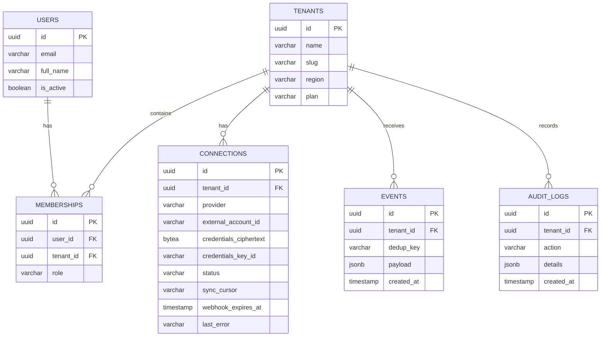

# Database Architecture

> [!NOTE] This file summarises the relational schema, key constraints, and row‑level security (RLS) policies that underpin OpsMind's multi‑tenant data isolation.

---

## 1. Core Tables (already migrated)
| Table | Primary Key | Important Columns | Description |
|-------|-------------|-------------------|-------------|
| **users** | `id` (uuid) | `email`, `full_name`, `is_active` | Application users; one‑to‑many with `memberships`. |
| **tenants** | `id` (uuid) | `name`, `slug`, `region`, `plan` | Organization container; each tenant has its own set of data. |
| **memberships** | `id` (uuid) | `user_id` (FK), `tenant_id` (FK), `role` | Links a user to a tenant with a role (Owner, Admin, Builder, …). |
| **connections** | `id` (uuid) | `tenant_id`, `provider`, `external_account_id`, `credentials_ciphertext`, `credentials_key_id`, `status`, `sync_cursor`, `webhook_expires_at`, `last_error` | Stores encrypted OAuth credentials for external services. |
| **events** | `id` (uuid) | `tenant_id`, `dedup_key`, `payload`, `created_at` | Normalised event store; deduplication via `dedup_key`. |
| **audit_logs** | `id` (uuid) | `tenant_id`, `action`, `details`, `created_at` | Immutable audit trail for compliance. |

## 2. Relationships (ER diagram)


## 3. Row‑Level Security (RLS)
The following PostgreSQL functions expose the current request's user and tenant derived from the JWT claims:
```sql
CREATE OR REPLACE FUNCTION app_user_id() RETURNS uuid AS $$
    SELECT nullif(current_setting('jwt.claims.sub', true), '')::uuid;
$$ LANGUAGE sql STABLE;

CREATE OR REPLACE FUNCTION app_tenant_id() RETURNS uuid AS $$
    SELECT nullif(current_setting('jwt.claims.tenant_id', true), '')::uuid;
$$ LANGUAGE sql STABLE;
```
Corresponding policies enforce tenant isolation:
```sql
ALTER TABLE users ENABLE ROW LEVEL SECURITY;
CREATE POLICY users_rls ON users USING (id = app_user_id());

ALTER TABLE tenants ENABLE ROW LEVEL SECURITY;
CREATE POLICY tenants_rls ON tenants USING (id = app_tenant_id());

ALTER TABLE memberships ENABLE ROW LEVEL SECURITY;
CREATE POLICY memberships_rls ON memberships USING (tenant_id = app_tenant_id());
```
All future tables **must** enable RLS and provide a matching policy (CI lint step enforces this).

## 4. Encryption Support (Connector credentials)
Connector credentials are stored encrypted (AES‑256‑GCM). The cipher text lives in `connections.credentials_ciphertext`; the `connections.credentials_key_id` column records which master key was used. Encryption/decryption helpers live in `app/connectors/crypto.py` (design stage).

---

*Generated on 2026‑11‑04 by Antigravity (AGY).*